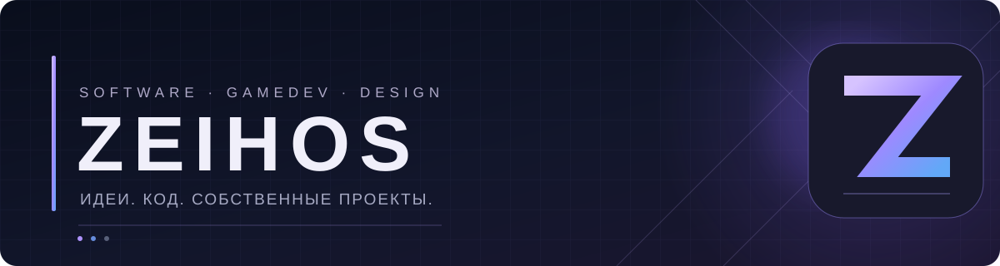

 

### Привет! Я Zeihos 👋

**Разрабатываю игры, приложения и собственные цифровые проекты.**  
Мне интересно создавать продукты с нуля — от идеи и дизайна до работающего прототипа.

  
  
  
  

[Проекты](#-избранные-проекты) · [Технологии](#-технологии) · [Все репозитории](https://github.com/Zeihos?tab=repositories)

---

## ◈ Чем занимаюсь

Разрабатываю **игры и игровые серверы**, **приложения для Windows**, инструменты автоматизации и собственные веб-проекты. Люблю продумывать архитектуру, интерфейсы и детали, которые делают продукт удобным. Многие проекты находятся на разных стадиях разработки и активно меняются.

## ✦ Избранные проекты

| Проект | Что это |
| :--- | :--- |
| **[NYVERRA: Echo Frontier](https://github.com/Zeihos/NYVERRA-Echo-Frontier)** | Многопользовательский survival-проект на Unreal Engine 5 с PvP, PvE и строительством. |
| **[RustMP](https://github.com/Zeihos/RustMP)** | Экспериментальная серверная платформа на Rust, изучающая совместимость с SA-MP и open.mp. |
| **[CLIPTORA](https://github.com/Zeihos/CLIPTORA)** | Локальный видеоредактор с инструментами анализа записей и подготовки игровых нарезок. |
| **[UMBRA: Shattered Night](https://github.com/Zeihos/UMBRA-Shattered-Night)** | Мод для Terraria с собственным игровым контентом. |
| **[VORNIXO](https://github.com/Zeihos/Vornixo)** | Браузерная survival-игра со строительством и защитой базы. |
| **[GAMEQIVA](https://github.com/Zeihos/Gameqiva)** | Система подбора и автоматической публикации игровых новостей в VK и Telegram. |
| **[VORQELI Connect](https://github.com/Zeihos/VORQELI)** | Windows-приложение для управления сетевыми инструментами. |
| **[LUMQERA](https://github.com/Zeihos/LUMQERA)** | Minecraft-проект с PvP, кланами и собственным серверным ядром. |
| **[TALQORIA](https://github.com/Zeihos/Talqoria)** | Minecraft-сервер с выживанием и экономикой. |
| **[GROWLIVO](https://github.com/Zeihos/GROWLIVO)** | Игровой проект на Roblox. |

<b>Другие проекты</b>

- [VARKENZA RolePlay](https://github.com/Zeihos/VARKENZA-RolePlay)
- [SUNKORA RolePlay](https://github.com/Zeihos/Sunkora-RP)
- [VELTOR RolePlay](https://github.com/Zeihos/Veltor-RP)
- [SLAVIA RolePlay](https://github.com/Zeihos/Slavia-RP)
- [OBSIDIAN RUSSIA](https://github.com/Zeihos/Obsidian-Russia)
- [DRAZVIO](https://github.com/Zeihos/Drazvio)
- [25011 — учебные материалы](https://github.com/Zeihos/25011)

## ⌘ Технологии

## ↗ Разработка и планы

В фокусе — развитие собственных проектов, улучшение качества кода, интерфейсов и пользовательского опыта. Публикую исходники и промежуточные результаты там, где проект открыт для сообщества.

> **Важно:** наличие репозитория не означает, что продукт уже выпущен. Актуальное состояние, инструкции по запуску и ограничения указаны в README соответствующего проекта.

---

**Спасибо, что заглянул!**  
[Посмотреть все мои репозитории](https://github.com/Zeihos?tab=repositories)

ZEIHOS · Build things that matter.

